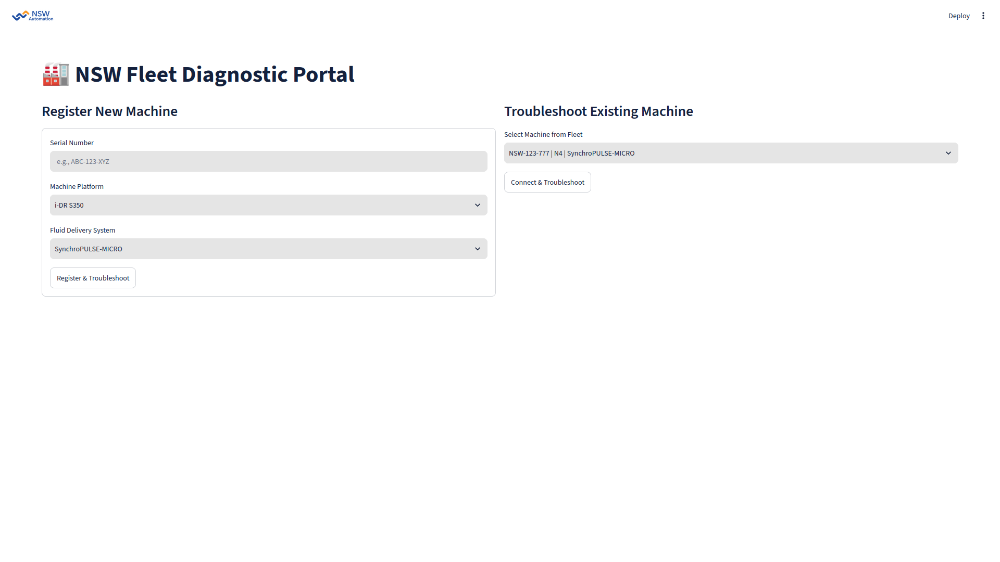
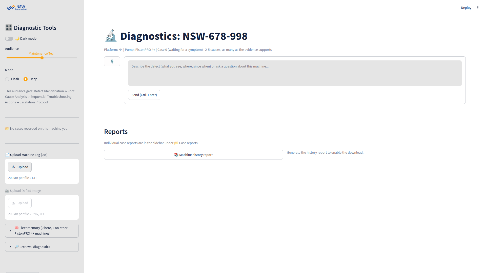
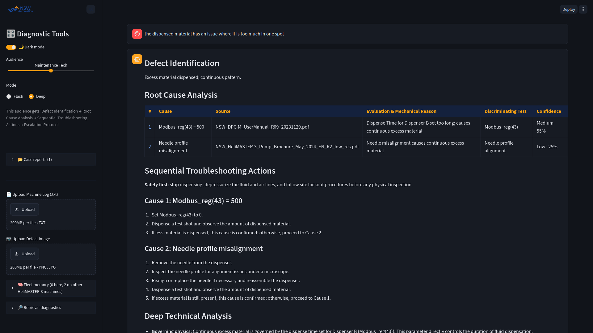
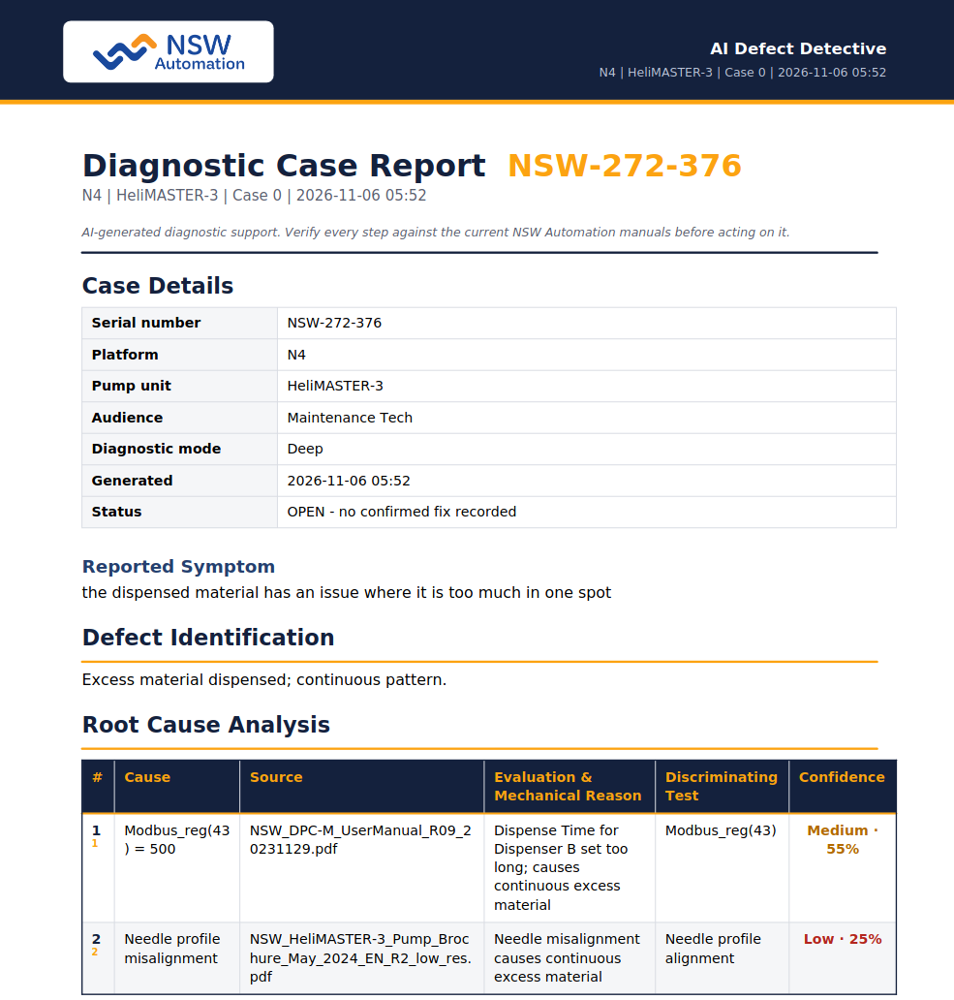
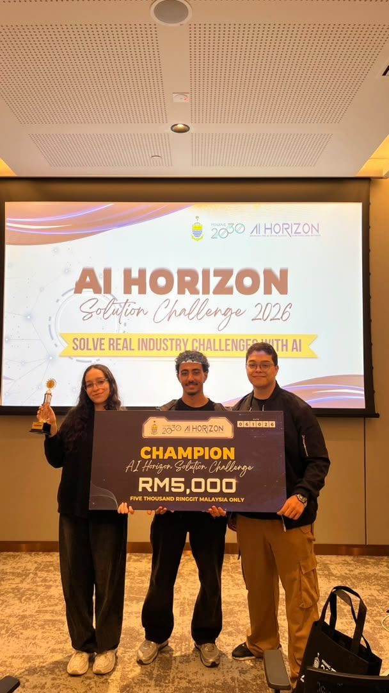
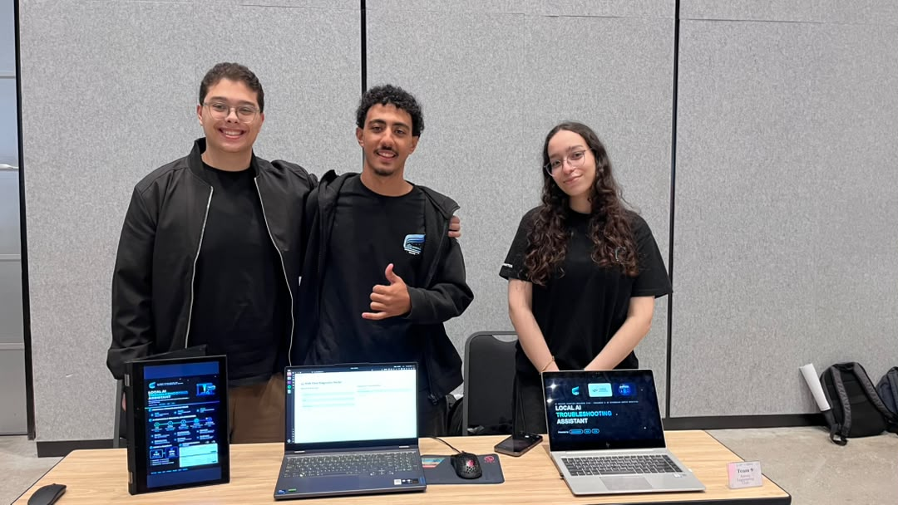

# 🏆 NSW Fleet Diagnostic Portal — Local AI Troubleshooting Assistant

> **🥇 1st Place Winner — Penang AI Horizon Solution Challenge 2026 (Challenge 2: AI Dispensing Defect Detective)**
> Built by **Aurora Engineering Club** in collaboration with **NSW Automation**

## 📖 Overview

Manufacturing and field service engineers at **NSW Automation** require rapid, accurate troubleshooting for high-precision micro-dispensing machines and pumps—without exposing proprietary machine schematics, logs, or company secrets to external cloud providers.

The **NSW Fleet Diagnostic Portal** is a **100% offline, edge-deployed Retrieval-Augmented Generation (RAG) system** that runs directly on factory hardware (requiring only a $\le 4\text{ GB}$ **VRAM laptop GPU** or running **CPU-only** on single-board computers like a Raspberry Pi). It grounds every root-cause analysis strictly in real NSW Automation and Nordson technical manuals, parses machine telemetry logs, tracks recurring defects across individual machine serial numbers, and generates escalation-ready PDF reports.

## ✨ Key Engineering Features & Metrics

* **📚 Hardware-Tagged Vector Knowledge Base:** Indexed **54 PDF technical manuals & brochures** into **4,954 searchable text chunks** covering **6 machine platforms** and **4 fluid delivery pump types** using **Qwen3 embeddings** and **ChromaDB**. Every chunk is metadata-tagged by platform and pump type to prevent cross-machine retrieval contamination.
* **🛡️ 5-Stage Guardrail & Verification Pipeline (`Ask → Check → Search → Answer → Verify`):**
* **Off-Topic Guard:** Combines strict context-wrapping with a vector distance threshold score to automatically reject non-troubleshooting queries.
* **Deterministic Self-Check:** Forces **Microsoft Phi-4-mini** (via **Ollama**) into a structured diagnostic schema and verifies that every cited source exists in the retrieved manual chunks before rendering.


* **⚡ Dual Diagnostic Modes (`Deep` vs. `Flash`):**
* **Deep Mode (Default):** Conducts up to 2 rounds of interactive clarifying questions with the operator to isolate ambiguous mechanical or pneumatic faults before diagnosing.
* **Flash Mode:** Immediate single-shot root-cause analysis for time-critical production line stops.


* **🎚️ Adaptive Audience Tone Slider (`Intern` ↔ `Senior Engineer`):** Dynamically adjusts output complexity—providing step-by-step safety lockouts and clear escalation protocols for new interns, or deep mechanical/register-level (`Modbus_reg`) analysis for senior engineers.
* **📈 Synthetic Machine Log Generator & Parser:** Includes a custom telemetry log generator and parser that ingests machine warning logs (e.g., `DISPENSE_VOLUME_LOW`, `PAT_ALIGN_BOARD`) and correlates parameter deviations directly with manual specifications.
* **🧠 Persistent Fleet Memory (SQLite) & Dual PDF Reporting:** Tracks every historical fault and confirmed fix under the machine's unique serial number, automatically flagging recurring anomalies and exporting **Diagnostic Case Reports** and **Full Machine History Archives** as PDFs.

## 🖼️ System Architecture & Portal Gallery

### Poster & Pipeline Architecture

### Portal Interface Screenshots

| Machine Registration | Chat Page |
| --- | --- |
|    |     |

| Sample output (Dark Mode) | Sample PDF Report |
| --- | --- |
|    |    |

## 🚀 Setup & Installation

> **Hardware Requirements:** Runs 100% locally offline. Supports systems with a $\le 4\text{ GB}$ **VRAM GPU** or **CPU-only** execution (e.g., Raspberry Pi / standard factory laptop). All libraries used are open-source and free for commercial use.

### Prerequisites

* Install python 3.14.4

### Step-by-Step Installation & Execution

1. Clone the repository: `git clone [https://github.com/eyadali05/rag-diagnostic-portal.git](https://github.com/eyadali05/rag-diagnostic-portal.git)`
2. Move into the cloned folder: `cd rag-diagnostic-portal/`
3. Create a new virtual environment: `python3 -m venv .venv`
4. Install all the required libraries by running: `pip3 install -r requirements.txt`
5. Install Ollama from [here](https://ollama.com/download)
6. Install the language model from Ollama: `ollama pull phi4-mini`
7. Install the embeddings model from Ollama: `ollama pull qwen3-embedding:0.6b`
8. Go into your terminal of choice and run the app: `streamlit run src/app.py`
9. Happy Troubleshooting :)

## 📂 Repository Structure

```text
├── documents/
│   └── RAG/
│       └── Master/                  # Documents used for RAG (not uploaded due to size)
├── src/
│   ├── chroma_db/                   # Vector database
│   ├── machine_logs/                # Synthetic testing logs generated by the system
│   ├── prompts/                     # Old context wrapping instructions md files
│   ├── app.py                       # Main program handling Streamlit UI
│   ├── database.py                  # Straightforward database operations
│   ├── eval_llm.py                  # Used for testing the LLM
│   ├── fleet_tracking.db            # Database for storing diagnostic solutions
│   ├── generate_machine_logs.py     # Generates the synthetic testing logs
│   ├── ingest.py                    # Parses the documents folder for RAG indexing
│   ├── log_parser.py                # Parses machine telemetry logs
│   ├── model.py                     # Handles the model
│   ├── report_pdf.py                # PDF report generator
│   └── reports.py                   # Report handler
└── requirements.txt                 # Python dependencies

```

## 🏆 Competition & Team (Aurora Engineering Club)

Developed for the **AI Horizon Solution Challenge 2026 (Challenge 2: AI Dispensing Defect Detective)** at the Penang Waterfront Convention Centre (PWCC), where the project was awarded **1st Place**.

### Team Members

* **Eyad Mohamed Ali** — Project Lead ([GitHub](https://github.com/eyadali05) | [LinkedIn](https://linkedin.com/in/eyad-mohamed-363b07238))
* **Abdelrahman Mohamed** — Team Member
* **Hoda Khaled** — Team Member

### Event & Award Gallery

| 1st Place Award Ceremony at PWCC | Team Aurora at AI Horizon 2026 |
| --- | --- |
|    |    |

## 📄 License

This project utilizes commercial-friendly open-source libraries and models. Built for educational and industrial R&D demonstration purposes. Under MIT License.
